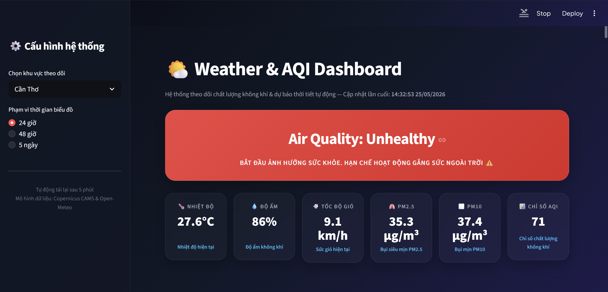
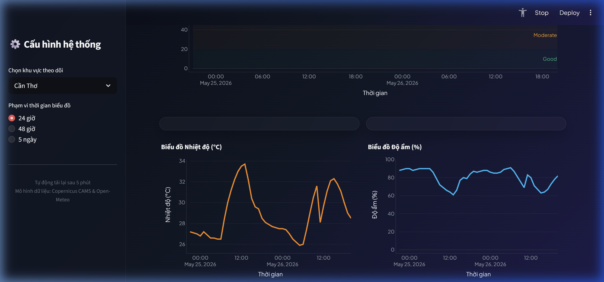
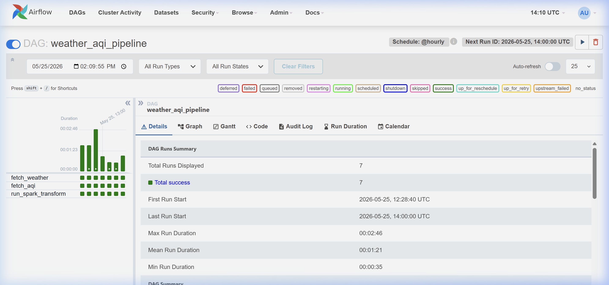
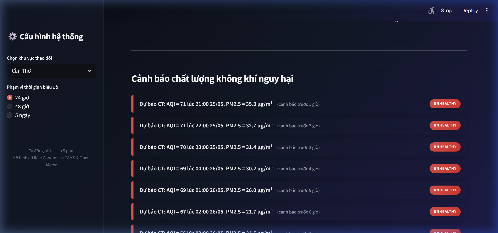
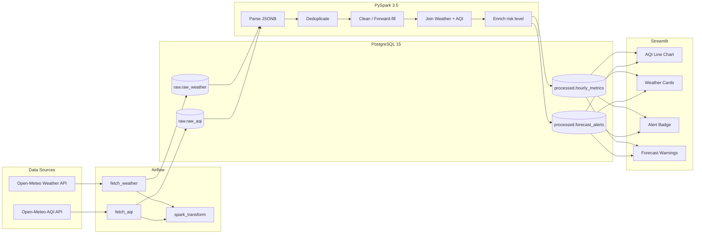

# Weather & AQI Pipeline — Vietnam


> End-to-end data pipeline thu thập, xử lý và cảnh báo chất lượng không khí cho 11 thành phố Việt Nam. Pipeline tự động lấy dữ liệu từ Open-Meteo API mỗi giờ, xử lý bằng Spark, và hiển thị trên dashboard .

---

## Mục lục

- [Demo](#demo)
- [Kiến trúc](#kiến-trúc)
- [Tech Stack](#tech-stack)
- [Quick Start](#quick-start)
- [Cấu trúc thư mục](#cấu-trúc-thư-mục)
- [Design Decisions](#design-decisions)
- [Pipeline Detail](#pipeline-detail)
- [Monitoring & Alerts](#monitoring--alerts)
- [Thành phố được monitor](#thành-phố-được-monitor)
- [License](#license)

---

## Demo

### Dashboard


*Dashboard hiển thị AQI & thời tiết thời gian thực cho 11 thành phố Việt Nam, với 6 Metric Cards glassmorphism tự động co giãn và thông số PM10/AQI bổ sung.*

### Charts


*Biểu đồ hiển thị AQI, Nhiệt độ và Độ ẩm được đồng bộ hóa chuẩn xác theo múi giờ địa phương Việt Nam (+7).*

### Airflow DAG


*Airflow DAG điều phối pipeline chạy mỗi giờ: lấy dữ liệu thời tiết & AQI, chạy Spark transform và tạo cảnh báo.*

### Alert Example


*Các cảnh báo dự báo ô nhiễm không khí được rút gọn thành 1 dòng tinh tế, có badge nguy hại căn lề phải và hiển thị thời gian cảnh báo trước rõ ràng.*

---

## Kiến trúc



---


## Tech Stack

| Layer | Technology | Lý do chọn |
|-------|-----------|-------------|
| **Orchestration** | Apache Airflow 2.9 | Retry logic, dependency management, backfill built-in, UI monitoring |
| **Ingestion** | Python + requests | Lightweight, đủ cho HTTP API calls |
| **Storage** | PostgreSQL 15 (JSONB) | Raw lưu nguyên payload để reprocess, processed lưu structured data |
| **Processing** | PySpark 3.5 | Window functions, scalable pattern, join 2 data sources |
| **Dashboard** | Streamlit + Plotly | Nhanh, interactive charts, deploy 1 lệnh |
| **Infrastructure** | Docker Compose | 1 lệnh chạy toàn bộ hệ thống |

---

## Quick Start

### Prerequisites

- Docker Desktop (≥ 4GB RAM allocated)
- Docker Compose v2.14+

### Chạy

```bash
# Clone repo
git clone https://github.com/<your-username>/weather-aqi-pipeline.git
cd weather-aqi-pipeline

# Tạo .env (optional, có default values)
cp .env.example .env

# Khởi động toàn bộ
docker compose up -d

# Chờ ~60 giây cho Airflow init xong, rồi mở:
# Airflow UI:  http://localhost:8080  (admin/admin)
# Dashboard:   http://localhost:8501
```

### Verify

```bash
# Check tất cả services healthy
docker compose ps

# Check data đã vào DB chưa (sau 1-2 phút)
docker exec -it weather-aqi-pipeline-postgres-data-1 \
  psql -U datauser -d weather_aqi \
  -c "SELECT count(*) FROM raw.raw_weather;"
```

### Dừng

```bash
docker compose down            # giữ data
docker compose down --volumes  # xóa sạch data
```

---

## Cấu trúc thư mục

```
weather-aqi-pipeline/
├── docker-compose.yml          # 5 services: 2 postgres, airflow-web, scheduler, streamlit
├── Dockerfile                  # Custom Airflow image + Java + PySpark
├── requirements.txt            # Python deps cho Airflow containers
├── Makefile                    # make run, make stop, make test
├── .env.example                # Environment variables template
│
├── dags/
│   └── weather_aqi_dag.py     # Main DAG: fetch → transform (hourly)
│
├── ingestion/
│   ├── config.py              # 11 cities, API URLs, DB config
│   ├── fetch_weather.py       # Gọi Open-Meteo Weather API
│   └── fetch_aqi.py           # Gọi Open-Meteo Air Quality API
│
├── spark/
│   ├── transform.py           # Parse → Clean → Join → Enrich → Write
│   └── thresholds.py          # European AQI thresholds (EEA source)
│
├── dashboard/
│   ├── Dockerfile
│   ├── requirements.txt
│   └── app.py                 # Streamlit dashboard
│
├── db/
│   └── init.sql               # Schema: raw + processed (auto-run on first boot)
│
├── tests/
│   ├── test_ingestion.py
│   ├── test_transform.py
│   └── test_alerts.py
│
├── notebooks/
│   └── eda.ipynb              # Correlation analysis: AQI vs weather patterns
│
└── docs/
    └── screenshots/           # Dashboard, DAG, alert screenshots
```
---

## Pipeline Detail

### DAG: `weather_aqi_pipeline`

| Task | Schedule | Mô tả |
|------|----------|--------|
| `fetch_weather` | @hourly | Gọi Open-Meteo cho 11 cities, insert JSONB vào `raw.raw_weather` |
| `fetch_aqi` | @hourly | Gọi Open-Meteo AQI cho 11 cities, insert vào `raw.raw_aqi` |
| `run_spark_transform` | After fetch | Parse → Deduplicate → Clean → Join → Enrich → Write processed |

```
fetch_weather ─┐
               ├──→ run_spark_transform
fetch_aqi ────┘
```

### Data Flow

```
1 API call per city = ~48 hourly data points (past_days=1, forecast_days=1)
11 cities × 48 points = 528 rows per ingestion cycle
528 rows × 24 cycles/day = ~12,672 rows/day in raw
After deduplicate: 11 × 48 = 528 unique rows in processed
```

### Spark Transform Steps

1. **Parse**: JSONB → explode arrays → 1 row per city per hour
2. **Deduplicate**: Giữ bản mới nhất (theo `ingested_at`) cho mỗi (city, timestamp)
3. **Clean**: Forward-fill null trong window 2 giờ, drop nếu null > 3 giờ liên tiếp
4. **Join**: Weather + AQI theo (city_code, timestamp_local) — exact join
5. **Enrich**: Tính `health_risk` theo European AQI thresholds (EEA)
6. **Alert**: Nếu forecast giờ tương lai >= Unhealthy → insert `forecast_alerts`

---

## Monitoring & Alerts

### Alert Levels (European AQI — EEA)

| Level | AQI Range | Màu | Hành động |
|-------|-----------|------|-----------|
| Good | 0–20 | 🟢 | Không cần |
| Moderate | 21–50 | 🟡 | Nhạy cảm nên lưu ý |
| Unhealthy | 51–100 | 🟠 | **Alert triggered** — hạn chế ra ngoài |
| Hazardous | 101+ | 🔴 | **Alert triggered** — nguy hiểm |

### Alert Format

```
Dự báo HN: AQI = 95 (Unhealthy) lúc 05:00 15/06. PM2.5 = 72 µg/m³
├── city_code: HN
├── forecast_for_time: 2025-06-15 05:00
├── lead_time_hours: 7 (phát hiện lúc 22:00 đêm trước)
└── health_risk: Unhealthy
```

---

## Thành phố được monitor

| Code | Thành phố | Lat | Lon |
|------|-----------|-----|-----|
| HCM | Hồ Chí Minh | 10.8231 | 106.6297 |
| HN | Hà Nội | 21.0285 | 105.8542 |
| DN | Đà Nẵng | 16.0544 | 108.2022 |
| HP | Hải Phòng | 20.8449 | 106.6881 |
| CT | Cần Thơ | 10.0452 | 105.7469 |
| HUE | Huế | 16.4637 | 107.5909 |
| NT | Nha Trang | 12.2388 | 109.1967 |
| DL | Đà Lạt | 11.9404 | 108.4583 |
| VT | Vũng Tàu | 10.3460 | 107.0843 |
| VINH | Vinh | 18.6796 | 105.6813 |
| QN | Quy Nhơn | 13.7713 | 109.2307 |

---


## License

MIT

---

