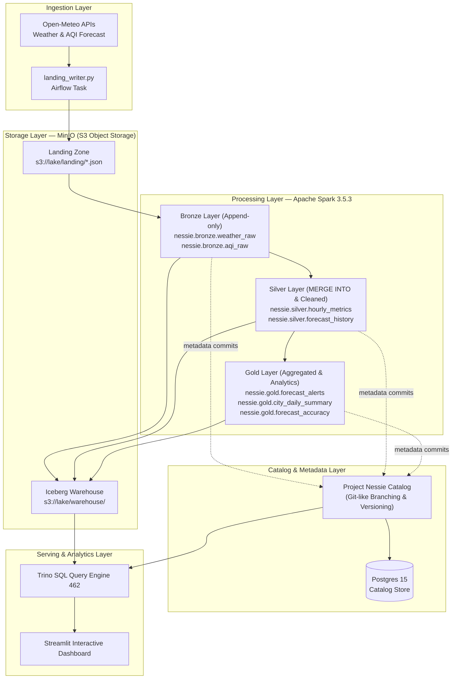

# Vietnam Weather & AQI Medallion Lakehouse


Hệ thống Data Lakehouse thu thập, chuẩn hóa, xử lý và giám sát thời gian thực chỉ số thời tiết & chất lượng không khí (AQI) cho **63 tỉnh thành Việt Nam**. Dự án áp dụng kiến trúc **Medallion Architecture (Landing → Bronze → Silver → Gold)** trên nền tảng lưu trữ hướng đối tượng S3 kết hợp định dạng bảng **Apache Iceberg**, quản lý metadata phiên bản kiểu Git với **Project Nessie**, và phân tích truy vấn tốc độ cao qua **Trino**.

---

## Mục lục

1. [Kiến trúc Medallion Lakehouse](#1-kiến-trúc-medallion-lakehouse)
2. [Công nghệ sử dụng (Tech Stack)](#2-công-nghệ-sử-dụng-tech-stack)
3. [Cấu trúc thư mục](#3-cấu-trúc-thư-mục)
4. [Hướng dẫn cài đặt & Khởi chạy](#4-hướng-dẫn-cài-đặt--khởi-chạy)
5. [Cổng dịch vụ & Thông tin đăng nhập](#5-cổng-dịch-vụ--thông-tin-đăng-nhập)
6. [Chi tiết các luồng Airflow DAG](#6-chi-tiết-các-luồng-airflow-dag)
7. [Truy vấn dữ liệu mẫu với Trino](#7-truy-vấn-dữ-liệu-mẫu-với-trino)
8. [Bảo trì Lakehouse & Khắc phục sự cố](#8-bảo-trì-lakehouse--khắc-phục-sự-cố)

---

## 1. Kiến trúc Medallion Lakehouse



### Các tầng dữ liệu trong Medallion Architecture:
* **Landing Zone (`s3://lake/landing/`)**: Lưu trữ JSON thô từ Open-Meteo API theo định dạng phân vùng thời gian `source=weather/dt=YYYY-MM-DD/hour=HH/*.json`.
* **Bronze Layer**: Đọc JSON từ Landing, parse kiểu dữ liệu và nạp dạng `append-only` vào bảng Iceberg. Lưu giữ toàn bộ dữ liệu thô phục vụ reprocess và audit.
* **Silver Layer**: Sử dụng cú pháp `MERGE INTO` (Upsert) để khử trùng lặp và ghi đè dự báo mới nhất cho cùng mốc thời gian, đồng thời bảo toàn lịch sử thay đổi dự báo vào bảng `forecast_history`.
* **Gold Layer**: Xây dựng bảng phục vụ phân tích nghiệp vụ:
  * `forecast_alerts`: Cảnh báo các mốc thời gian ô nhiễm không khí trong tương lai.
  * `city_daily_summary`: Tổng hợp min, max, avg nhiệt độ và AQI theo ngày cho từng tỉnh thành.
  * `forecast_accuracy`: Tính toán chỉ số sai số dự báo (MAE, Bias, RMSE) theo từng khoảng thời gian (lead time).

---

## 2. Công nghệ sử dụng (Tech Stack)

| Thành phần | Công nghệ | Chi tiết cấu hình | Vai trò trong hệ thống |
|:---|:---|:---|:---|
| **Storage** | MinIO | S3 API (`:9000`), Console (`:9001`) | Lưu trữ toàn bộ Landing JSON và Iceberg Parquet files |
| **Table Format** | Apache Iceberg 1.7.1 | `iceberg-spark-runtime`, `iceberg-aws-bundle` | Hỗ trợ ACID transactions, schema evolution, hidden partitioning |
| **Catalog** | Project Nessie 0.99.0 | JDBC Backend (`PostgreSQL 15`) | Quản lý phiên bản metadata, snapshot isolation cho Data Lake |
| **Compute** | Apache Spark 3.5.3 | Standalone Master + Worker | Thực thi các batch jobs Bronze, Silver, Gold và bảo trì lakehouse |
| **Query Engine** | Trino 462 | Iceberg Connector | Truy vấn SQL phân tán trực tiếp từ Iceberg tables qua Nessie |
| **Orchestration** | Apache Airflow 2.9.3 | LocalExecutor (`PostgreSQL 15`) | Điều phối pipeline định kỳ mỗi giờ, quản lý retry và cảnh báo |
| **Dashboard** | Streamlit + Plotly | Trino Python Client | Giao diện trực quan hóa dữ liệu thời gian thực và độ chính xác dự báo |

---

## 3. Cấu trúc thư mục

```
weather-aqi-pipeline/
├── docker-compose.yml              # Cấu hình 10 containers của hệ thống
├── Dockerfile                      # Image Airflow tích hợp Java 17 + Spark client
├── dags/                           # Airflow DAGs
│   ├── hourly_ingest.py            # DAG chính: Landing → Bronze → Silver → Gold
│   ├── lake_maintenance.py         # DAG bảo trì: Compaction & Snapshot Expiry
│   └── backfill.py                 # DAG nạp bù dữ liệu lịch sử theo khoảng thời gian
├── ingestion/                      # Ingestion Layer
│   ├── config.py                   # Tọa độ 63 tỉnh thành & cấu hình MinIO
│   └── landing_writer.py           # Gọi Open-Meteo API và ghi JSON lên MinIO
├── spark/                          # Spark Jobs & thư viện
│   ├── common/
│   │   ├── session.py              # Khởi tạo SparkSession kết nối Nessie/Iceberg
│   │   └── transforms.py           # Logic transform chuẩn hóa, join & tính AQI
│   ├── jobs/
│   │   ├── bronze_load.py          # Nạp JSON Landing vào Bronze Iceberg
│   │   ├── silver_merge.py         # Incremental MERGE INTO Silver
│   │   ├── gold_build.py           # Tạo các bảng Gold Analytics
│   │   └── maintenance.py          # Rewrite data files, expire snapshots
│   └── thresholds.py               # Thang đo phân cấp chất lượng không khí
├── dashboard/                      # Giao diện trực quan hóa
│   ├── app.py                      # Ứng dụng Streamlit truy vấn qua Trino
│   ├── requirements.txt            # Thư viện cho Dashboard
│   └── Dockerfile                  # Container Dashboard
├── infra/                          # Cấu hình hạ tầng
│   ├── spark/spark-defaults.conf   # Cấu hình Iceberg, Nessie, S3FileIO cho Spark
│   ├── trino/catalog/iceberg.properties # Cấu hình Trino Iceberg connector
│   └── postgres/init-databases.sql # Khởi tạo database cho Airflow và Nessie
└── scripts/
    └── verify_lakehouse.py         # Script kiểm tra tích hợp toàn diện hệ thống
```

---

## 4. Hướng dẫn cài đặt & Khởi chạy

### Yêu cầu hệ thống
* **Docker Desktop** (với WSL2 backend trên Windows hoặc Docker Engine trên Linux).
* **RAM khuyến nghị**: Tối thiểu 10GB được cấp phát cho Docker/WSL2.
  * *Trên Windows*: Tạo hoặc chỉnh sửa file `%USERPROFILE%\.wslconfig`:
    ```ini
    [wsl2]
    memory=10GB
    swap=4GB
    ```
    Sau đó chạy `wsl --shutdown` trên PowerShell để áp dụng.

### Khởi động hệ sinh thái Lakehouse

1. Clone repository và di chuyển vào thư mục dự án:
   ```bash
   git clone https://github.com/Phucvt123/weather-aqi-pipeline.git
   cd weather-aqi-pipeline
   ```

2. Khởi động toàn bộ stack bằng Docker Compose:
   ```bash
   docker compose up -d --build
   ```
   > *Lưu ý*: Lần khởi động đầu tiên sẽ mất khoảng 5-8 phút để build Airflow image và tải các gói thư viện cần thiết.

3. Kiểm tra trạng thái các container:
   ```bash
   docker compose ps
   ```
   Đảm bảo các container chính (`lakehouse-minio`, `lakehouse-postgres`, `lakehouse-nessie`, `lakehouse-spark-master`, `lakehouse-trino`, `lakehouse-airflow-web`, `lakehouse-airflow-scheduler`) đều ở trạng thái `Up` hoặc `healthy`.

---

## 5. Cổng dịch vụ & Thông tin đăng nhập

| Dịch vụ | Địa chỉ truy cập | Tài khoản / Mật khẩu | Chức năng |
|:---|:---|:---|:---|
| **Airflow UI** | [http://localhost:8080](http://localhost:8080) | `admin` / `admin` | Giám sát & kích hoạt các pipeline |
| **Streamlit Dashboard** | [http://localhost:8501](http://localhost:8501) | *(Không cần đăng nhập)* | Xem báo cáo & dashboard trực quan |
| **MinIO Console** | [http://localhost:9001](http://localhost:9001) | `minioadmin` / `minioadmin123` | Quản lý Bucket & Object Storage |
| **Trino Web UI** | [http://localhost:8083](http://localhost:8083) | User bất kỳ (ví dụ: `admin`) | Giám sát các câu lệnh truy vấn phân tán |
| **Spark Master UI** | [http://localhost:8082](http://localhost:8082) | *(Không cần đăng nhập)* | Quản lý cluster & theo dõi job thực thi |
| **Nessie Catalog API** | [http://localhost:19120/api/v2/config](http://localhost:19120/api/v2/config) | REST API | Quản lý metadata commit & branches |

---

## 6. Chi tiết các luồng Airflow DAG

### 1. `hourly_ingest` (Chạy mỗi giờ)
DAG điều phối chính cho chu kỳ dữ liệu:
* **`ingest_to_landing`**: Gọi API Open-Meteo lấy thông tin thời tiết & AQI cho 63 tỉnh thành, ghi các file JSON vào MinIO Landing Zone.
* **`bronze_load`**: Spark job đọc dữ liệu Landing, nạp dạng append vào bảng `nessie.bronze.weather_raw` và `nessie.bronze.aqi_raw`.
* **`silver_merge`**: Khử trùng lặp, nội suy dữ liệu khuyết thiếu, áp dụng `MERGE INTO` để cập nhật dữ liệu mới nhất vào `nessie.silver.hourly_metrics`.
* **`gold_build`**: Tính toán các chỉ số cảnh báo ô nhiễm và tổng hợp ngày vào các bảng Gold.

### 2. `lake_maintenance` (Chạy hằng ngày lúc 03:00 UTC)
DAG thực hiện bảo trì định kỳ cho các bảng Iceberg:
* **Compaction (`rewrite_data_files`)**: Gộp nhiều file Parquet nhỏ phát sinh mỗi giờ thành các file kích thước chuẩn (~128MB) giúp tối ưu tốc độ đọc.
* **Expire Snapshots**: Xóa các commit metadata cũ hơn 7 ngày để giải phóng dung lượng lưu trữ trên MinIO.
* **Remove Orphan Files**: Dọn dẹp các file rác phát sinh ngoài luồng trên storage.

### 3. `backfill` (Chạy thủ công khi cần)
Dùng để tải dữ liệu lịch sử trong quá khứ:
* Mở giao diện Airflow → Chọn DAG `backfill` → **Trigger DAG w/ config**.
* Truyền tham số mốc thời gian:
  ```json
  {
    "start_date": "2024-01-01",
    "end_date": "2024-01-31"
  }
  ```

---

## 7. Truy vấn dữ liệu mẫu với Trino

Bạn có thể kết nối vào Trino container để thực thi truy vấn trực tiếp trên các bảng Iceberg:

```bash
docker exec -it lakehouse-trino trino
```

Một số câu truy vấn mẫu:

```sql
-- 1. Xem số lượng bản ghi chất lượng không khí trong Silver layer
SELECT COUNT(*) AS total_rows FROM iceberg.silver.hourly_metrics;

-- 2. Xem các chỉ số mới nhất tại Hà Nội và TP. Hồ Chí Minh
SELECT city_name, timestamp_local, temperature_c, humidity_pct, pm2_5, aqi_eu, health_risk
FROM iceberg.silver.hourly_metrics
WHERE city_code IN ('HN', 'HCM')
ORDER BY timestamp_local DESC
LIMIT 10;

-- 3. Xem danh sách cảnh báo ô nhiễm không khí trong tương lai (Gold layer)
SELECT city_name, forecast_for_time, lead_time_hours, health_risk, message
FROM iceberg.gold.forecast_alerts
ORDER BY forecast_for_time ASC
LIMIT 10;

-- 4. Xem tổng hợp thông số trung bình ngày gần nhất của các tỉnh thành
SELECT date_local, city_code, temp_avg, aqi_avg, hours_unhealthy
FROM iceberg.gold.city_daily_summary
WHERE date_local = CURRENT_DATE - INTERVAL '1' DAY
ORDER BY aqi_avg DESC
LIMIT 10;
```

---

## 8. Bảo trì Lakehouse & Khắc phục sự cố

* **Dừng toàn bộ hệ thống (giữ nguyên dữ liệu)**:
  ```bash
  docker compose down
  ```
* **Khởi động lại hệ thống**:
  ```bash
  docker compose up -d
  ```
* **Xóa hoàn toàn dữ liệu để cài đặt lại từ đầu**:
  ```bash
  docker compose down --volumes
  ```
* **Lỗi bộ nhớ hoặc Spark Executor thoát đột ngột**:
  * Kiểm tra cấu hình RAM của WSL2/Docker Desktop (cần tối thiểu 10GB RAM).
  * Xem logs chi tiết của worker: `docker logs lakehouse-spark-worker --tail 100`.
* **Kiểm tra logs Airflow Webserver / Scheduler**:
  ```bash
  docker logs lakehouse-airflow-web --tail 50
  docker logs lakehouse-airflow-scheduler --tail 50
  ```
